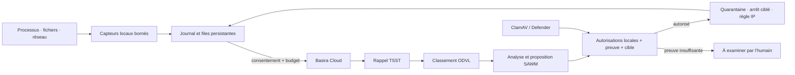

# SAWM Defense

**Une application de défense pour les postes de travail, le même agent en CLI pour les serveurs.**

SAWM Defense relie les observations locales à **SAWM Cloud**, à la mémoire **Basira**, au rappel **TSST** et au classement **ODVL**. L’utilisateur configure son espace, sa clé et les interventions autorisées. Les moteurs privés ne sont pas distribués dans ce client.

Version **0.1.0 — pilote logiciel**. Application macOS construite et vérifiée localement ; installateurs source Linux/Windows et construction native par CI fournis. Les commandes pare-feu et services Windows/Linux demandent encore une validation sur ces systèmes. Ce client n’est pas une certification antivirus ou un EDR noyau exhaustif.

## Ce que fait l’application

- Tableau de bord natif, CPU/RAM, processus, connexions accessibles et graphique d’activité.
- Dossiers choisis : création, modification et suppression, empreintes SHA256, limites de couverture visibles.
- Inventaire des applications installées ; analyse de fichiers avec **ClamAV** ou **Microsoft Defender**, lorsqu’ils sont disponibles.
- Détection antivirus locale confirmée → quarantaine automatique si l’utilisateur l’autorise → restauration explicite.
- Proposition de SAWM → vérification locale des droits, de la preuve et de la cible → intervention ou demande de validation.
- Arrêt ciblé d’un processus autorisé et blocage ciblé d’une IP autorisée, avec confirmation humaine. Pas de commande shell produite par un LLM.
- Dialogue avec SAWM, précédents rappelés par TSST et classement ODVL consultatif ; le chat ne peut pas autoriser une action.
- Journal persistant, appels Cloud, consommation en jetons lorsque l’API la fournit, rapports HTML/JSON.
- File Cloud idempotente et file de scans persistantes. Sans Cloud, les capteurs et la quarantaine autorisée continuent ; les transmissions attendent la reprise.
- Service utilisateur au démarrage, activé volontairement depuis l’interface ou la CLI.

La résilience concerne **la surveillance et la livraison des observations**. Le programme ne répare pas une liaison physique coupée et ne promet pas une protection contre un administrateur hostile.

## Installer

### macOS Apple Silicon

Ouvrir le DMG et glisser **SAWM Defense.app** dans Applications. Pour un pilote interne, le paquet est signé ad hoc, sans notarisation Apple : une distribution commerciale devra être signée avec un certificat Developer ID et notarisée.

La même application fonctionne en terminal :

```bash
"/Applications/SAWM Defense.app/Contents/MacOS/SAWM Defense" doctor
"/Applications/SAWM Defense.app/Contents/MacOS/SAWM Defense" watch
```

### Linux

Python 3.12+, `venv` et Tk doivent être installés. Sur Ubuntu 24.04 :

```bash
sudo apt install python3 python3-venv python3-tk
./packaging/install-linux.sh
~/.local/share/sawm-defense-app/sawm-defense gui
~/.local/share/sawm-defense-app/sawm-defense watch
```

L’installation est limitée à l’utilisateur. Elle ajoute une entrée au menu Applications. Aucune règle pare-feu ni élévation des privilèges n’est déclenchée pendant l’installation.

### Windows

Installer Python 3.12 avec Tcl/Tk depuis Python.org, puis lancer :

```powershell
powershell -NoProfile -File .\packaging\install-windows.ps1
```

Un raccourci **SAWM Defense** est créé dans le menu Démarrer. La CLI se trouve dans `%LOCALAPPDATA%\SAWM Defense App\SAWM Defense.cmd`. Microsoft Defender doit être actif pour son intégration. Son résultat ambigu reste « à examiner » ; aucune détection n’est inventée.

### Développement et paquets natifs

```bash
python3.12 -m venv .venv
# Linux/macOS : source .venv/bin/activate
# Windows : .venv\Scripts\Activate.ps1
python -m pip install '.[dev]'
python -m sawm_defense
python -m pytest -q
python packaging/build.py
```

Le workflow `.github/workflows/build.yml` teste et construit sur macOS, Windows et Linux. PyInstaller doit tourner sur l’OS cible ; un paquet Mac n’est pas un exécutable Windows.

## Première configuration

1. Dans la console [Basira Cloud](https://basira.sawm.io/espace), utiliser un espace et une entité dédiés à la machine. Créer une clé pour ce seul périmètre.
2. Dans **Réglages**, saisir l’URL, l’espace, l’entité et la clé. Les scopes nécessaires sont `events:write`, `jobs:read`, `memory:recall`, `tsst:recall`, `odvl:rank`, `sawm:run`, avec les droits de lecture/écriture correspondants sur l’entité.
3. Choisir les dossiers surveillés. Aucun dossier personnel n’est sélectionné par défaut.
4. Tester la connexion. Ce test confirme TSST et ODVL ; l’écriture et SAWM sont vérifiés à leur utilisation.
5. Activer le Cloud, puis **séparément** l’envoi des observations si souhaité. Les noms, chemins, empreintes et métadonnées sélectionnés peuvent être transmis. Le contenu brut des fichiers n’est pas envoyé automatiquement.
6. Choisir les actions et leurs limites. La quarantaine automatique demande un moteur antivirus local et une détection vérifiée. Processus et IP restent soumis à confirmation.
7. Démarrer la surveillance. Installer le démarrage automatique seulement après cette vérification.

Les clés sont dans le coffre natif (Trousseau macOS, Credential Manager Windows, Secret Service/KWallet Linux), liées à leur destination Cloud. Sans coffre accessible, une session en mémoire est possible ; aucune clé n’est écrite en clair. Un serveur Linux sans session de coffre doit être configuré avec son administrateur ; une clé de session ne survit pas au redémarrage.

## Fonctionnement



Un nom de fichier ou un journal contenant « ignore les règles » reste une donnée. Les faits historiques rappelés ne prouvent pas l’état actuel. Ni le modèle ni un souvenir ne peuvent élargir les droits de l’utilisateur.

## Couverture honnête

| Fonction | macOS | Linux | Windows |
|---|---|---|---|
| Fichiers sélectionnés, SHA256, CPU/RAM | Code exécuté et testé | Code portable, validation native à poursuivre | Code portable, validation native à poursuivre |
| Processus et connexions | Selon permissions OS ; réseau parfois refusé | Selon permissions OS | Selon permissions OS |
| Antivirus | ClamAV installé | ClamAV installé | Defender ou ClamAV installé |
| Quarantaine/restauration | Test réel sur fichiers temporaires | Implémentation portable | Implémentation portable |
| Blocage IP ciblé | Non implémenté dans ce pilote | UFW déjà actif + droits administrateur | Pare-feu Windows + droits administrateur |
| Démarrage utilisateur | LaunchAgent | systemd utilisateur | Tâche planifiée à l’ouverture de session |
| Pilote noyau, inspection des paquets, root hostile | Non | Non | Non |

Un inventaire ou un hash n’établit pas qu’un logiciel est sain. Un binaire installé ne donne pas automatiquement accès à son code source. Le programme observe les connexions disponibles ; il n’intercepte pas tous les téléchargements avant leur écriture ou leur exécution. La surveillance par sondage peut manquer des opérations très brèves.

## Budget, stockage et preuves

Le budget par défaut est **4 opérations Cloud par heure**. Une opération peut déclencher plusieurs requêtes HTTP ; chaque appel effectif est journalisé. L’interface présente les jetons fournis par l’API, sans inventer les coûts absents.

La rétention locale par défaut est de 30 jours. Les observations en attente de livraison/analyse sont conservées, donc une longue panne ou un flot d’événements peut augmenter le stockage. Prévoir une supervision du disque en exploitation. Le journal possède une chaîne d’intégrité détectant des modifications incohérentes, pas une preuve inviolable contre un administrateur de la machine. Les quarantaines restent conservées jusqu’à décision humaine.

Voir [guide CLI](docs/CLI.md), [interface](docs/INTERFACE.md), [architecture et limites](docs/ARCHITECTURE.md) et [validation](docs/VALIDATION.md).
