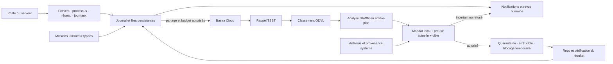

# SAWM Defense

[](https://github.com/SAWM-io/sawm-defense/actions/workflows/build.yml)

[Télécharger la version pilote](https://github.com/SAWM-io/sawm-defense/releases) · [Guide pas à pas](docs/INTERFACE.md) · [Serveurs / CLI](docs/CLI.md)

**Votre agent surveille, signale et intervient dans les limites que vous lui confiez.**

Une application de défense pour **macOS, Linux et Windows**, le même service en **CLI pour les serveurs**. SAWM Defense relie les observations du poste à **SAWM Cloud**, à la mémoire **Basira**, au rappel **TSST** et au classement **ODVL**. Configurez votre espace et vos autorisations : la veille fonctionne ensuite sans attendre une question dans le chat.

**Version 0.2.0 — pilote logiciel.** Le code de collecte, d’analyse et de contrôle est commun à l’application et à la CLI. Le client utilise les API publiques : les moteurs privés SAWM, Basira, TSST et ODVL ne sont pas distribués. La matrice de couverture ci-dessous distingue les essais macOS des validations Linux/Windows encore nécessaires.

## Ce que l’agent fait pour vous

- **Veiller en continu** : fichiers, processus, connexions visibles et consommation CPU/RAM, avec état réel des capteurs et limites de couverture.
- **Examiner les téléchargements** : repérer les fichiers nouveaux ou modifiés, attendre leur stabilité, inspecter leur structure et appeler l’antivirus local lorsqu’il existe.
- **Inspecter même sans antivirus** : caractéristiques du fichier, en-têtes, type réel, métadonnées, archives et informations de signature disponibles. Un résultat douteux produit une alerte, pas une déclaration infondée de malware.
- **Relier les signaux** : suivre les événements, retrouver les précédents autorisés avec Basira/TSST, les classer avec ODVL et faire analyser les alertes par SAWM en arrière-plan.
- **Alerter sans demande préalable** : boîte de notifications persistante et notification native du système. Livraison, échec et accusé de lecture restent distincts.
- **Intervenir selon votre mandat** : quarantaine, arrêt ciblé et blocage IP, soumis à des preuves locales vérifiées, des cibles attribuées et vos périmètres. Vous choisissez séparément les interventions automatiques.
- **Repérer les tentatives SSH répétées** : seuil et fenêtre temporelle, provenance du journal, adresses protégées ; blocage temporaire possible à partir d’une source Linux fiable et d’une autorisation explicite.
- **Recevoir des missions** : scan, inventaire, analyse, rapport ; file persistante, identité de la session demandeuse, état et résultat. Les actions et restaurations passent par le même contrôle local.
- **Expliquer et rendre compte** : dialogue SAWM, journal d’actions, refus, reçus Cloud, jetons lorsque fournis et exports HTML/JSON.
- **Continuer localement pendant une panne Cloud** : observations et tâches restent conservées ; la collecte et les protections locales autorisées ne dépendent pas d’une réponse immédiate du modèle.

La résilience concerne la surveillance et la livraison des observations. Le programme ne répare pas une liaison physique coupée. Une détection antivirus vérifiée est distincte d’un indice structurel ou d’une hypothèse SAWM.

## Installer

**Le chemin le plus simple :** sur Mac Apple Silicon, téléchargez le DMG dans les [versions publiées](https://github.com/SAWM-io/sawm-defense/releases). Sur Linux ou Windows, téléchargez et décompressez l’archive des sources, puis lancez l’installateur ci-dessous depuis ce dossier. Vous pouvez aussi récupérer les sources avec Git :

```bash
git clone https://github.com/SAWM-io/sawm-defense.git
cd sawm-defense
```

Au premier lancement, la veille locale et l’inspection des téléchargements démarrent. **Aucune intervention ni transmission Cloud n’est autorisée par défaut.** Ouvrez **Réglages** pour connecter votre compte, choisir les dossiers et autoriser les actions souhaitées ; **Veille & missions** présente les alertes et les tâches.

### macOS Apple Silicon

Ouvrez le DMG correspondant à la version publiée et glissez **SAWM Defense.app** dans Applications. Les paquets de pilote sont signés ad hoc ; une distribution commerciale nécessite Developer ID et notarisation Apple. Les nouveaux fichiers source ne mettent pas à jour automatiquement un ancien DMG.

Le paquet expose aussi la CLI :

```bash
"/Applications/SAWM Defense.app/Contents/MacOS/SAWM Defense" doctor
"/Applications/SAWM Defense.app/Contents/MacOS/SAWM Defense" watch
```

### Linux

**Binaire prêt à lancer, sans Python :** téléchargez l’archive `linux-x86_64.tar.gz` dans les versions, décompressez-la, ouvrez son dossier puis lancez `./sawm-defense/sawm-defense gui` ou `./sawm-defense/sawm-defense watch` pour un serveur. Gardez le dossier `sawm-defense` complet : ses bibliothèques accompagnent l’exécutable. La construction Linux cible Ubuntu 24.04 x86-64 et un système compatible ; ce n’est pas un paquet pour toutes les versions de Linux.

**Installation depuis les sources :**

Python 3.12+, `venv` et Tk sont nécessaires. Exemple Ubuntu 24.04 :

```bash
sudo apt install python3 python3-venv python3-tk
./packaging/install-linux.sh
~/.local/share/sawm-defense-app/sawm-defense gui
~/.local/share/sawm-defense-app/sawm-defense watch
```

L’installation utilisateur crée une entrée au menu Applications. Les droits système et règles pare-feu ne sont pas accordés pendant cette installation. Les capteurs noyau Linux supplémentaires se configurent explicitement ; voir [le guide noyau](docs/KERNEL.md).

### Windows

**Binaire prêt à lancer, sans Python :** téléchargez l’archive `windows-x86_64.zip` dans les versions, extrayez-la entièrement puis ouvrez `sawm-defense/sawm-defense.exe`. Pour la CLI, lancez ce même exécutable avec `doctor` ou `watch`. Le pilote n’a pas encore de signature Authenticode commerciale.

**Installation depuis les sources :**

Installez Python 3.12 avec Tcl/Tk depuis Python.org, puis :

```powershell
powershell -NoProfile -File .\packaging\install-windows.ps1
```

Le raccourci **SAWM Defense** apparaît dans le menu Démarrer. CLI : `%LOCALAPPDATA%\SAWM Defense App\SAWM Defense.cmd`. L’intégration Microsoft Defender requiert son activation. Une réponse ambiguë du moteur reste à examiner.

### Depuis les sources

```bash
python3.12 -m venv .venv
# Linux/macOS : source .venv/bin/activate
# Windows : .venv\Scripts\Activate.ps1
python -m pip install '.[dev]'
python -m sawm_defense
python -m pytest -q
python packaging/build.py
```

Le workflow `.github/workflows/build.yml` fournit les constructions natives. PyInstaller doit fonctionner sur l’OS cible ; un paquet Mac n’est pas un exécutable Windows.

## Première configuration

1. **Veille locale** : vérifiez les chemins et l’option Téléchargements. La surveillance au lancement et l’inspection automatique sont activables indépendamment des interventions. Le Cloud peut rester désactivé.
2. **Espace Cloud dédié** : dans [Basira Cloud](https://basira.sawm.io/espace), créez une mémoire pour ce poste et une clé limitée à ce périmètre. Les scopes utilisés sont `events:write`, `jobs:read`, `memory:recall`, `tsst:recall`, `odvl:rank`, `sawm:run`, avec les droits correspondants sur l’entité.
3. **Connexion** : renseignez URL, espace, entité et clé, puis vérifiez l’accès. La vérification TSST/ODVL n’est pas un essai d’écriture ou d’inférence SAWM ; ces opérations sont vérifiées lors de leur utilisation.
4. **Partage explicite** : activez séparément les fonctions Cloud et l’envoi de métadonnées. Noms, chemins, empreintes et attribution peuvent entrer dans le contexte. Les contenus bruts ne sont pas automatiquement téléversés.
5. **Mandat d’action** : choisissez les permissions de quarantaine, arrêt et blocage, les cibles autorisées et les exclusions. L’interface confirme l’élargissement des permissions. Une réponse du modèle ne modifie jamais ce mandat.
6. **Service permanent** : après vérification du comportement, installez volontairement le démarrage supervisé depuis les réglages ou la CLI. Fermer une console ne doit pas être confondu avec arrêter un service séparé.

Les clés résident dans le coffre natif, liées à la destination Cloud. Sans coffre disponible, une clé en mémoire est possible pour une session ; aucune clé n’est écrite en clair. Sur un serveur sans session de coffre, préparez la gestion des secrets avec l’administrateur.

Pour une session serveur sans coffre natif, configurez d’abord l’espace et l’entité, puis lancez `sawm-defense watch --prompt-key` : la saisie est masquée et la clé reste en mémoire jusqu’à l’arrêt. Elle n’est pas passée en argument ni conservée pour un redémarrage automatique.

## De l’observation à l’action



Le modèle aide à analyser. Le système local vérifie l’autorité et exécute les seules opérations prévues. Un texte provenant d’un fichier, d’un journal ou d’une réponse Cloud reste une donnée : il ne devient jamais une commande shell. Un souvenir historique ne prouve pas l’état actuel d’une cible.

### Télécharger n’est pas exécuter

Le programme inspecte les fichiers observés sur disque. Il ne garantit pas l’interception de chaque téléchargement **avant** écriture ou exécution. Sans antivirus, `no_indicator` signifie « aucun indicateur reconnu dans les contrôles réalisés », pas « fichier sain ». `suspicious` demande une revue ; `incomplete` indique une limite. L’inspection seule ne fournit pas la preuve antivirus exigée pour une intervention automatique destructrice.

## Couverture par système

| Fonction | macOS | Linux | Windows |
| --- | --- | --- | --- |
| Fichiers sélectionnés, empreintes, CPU/RAM, interface | Essais locaux réels ; voir validation | Code portable, campagne native à compléter | Code portable, campagne native à compléter |
| Processus et connexions | Selon droits ; certaines mesures réseau peuvent être refusées | Selon droits | Selon droits |
| Inspection structurelle de fichiers | Contrôles locaux bornés | Contrôles portables | Contrôles portables |
| Antivirus à signatures | ClamAV s’il est installé | ClamAV s’il est installé | Defender ou ClamAV selon disponibilité |
| Notifications | Intégration native selon autorisations OS | Service de notifications si disponible ; boîte locale sinon | Intégration native selon environnement ; boîte locale sinon |
| Quarantaine/restauration | Essais sur fichiers temporaires inoffensifs | Implémentation portable | Implémentation portable |
| Blocage IP | Non implémenté dans ce pilote | UFW déjà actif et droits adéquats | Pare-feu Windows et droits adéquats |
| Échecs SSH attribués par source système fiable | Pas de source native équivalente validée | Journal système Linux, activation explicite | Pas de source native équivalente validée |
| Collecte noyau supplémentaire | Pas d’extension Endpoint Security distribuée | Règles audit Linux sur périmètre choisi ; traces consultables nativement, pas encore importées dans l’application | Pas de pilote noyau distribué |
| Démarrage utilisateur | LaunchAgent | systemd utilisateur | Tâche planifiée à l’ouverture de session |

L’agent ne réside pas dans le noyau. Il emploie les interfaces du système selon les permissions. La lecture d’un binaire ne donne pas son code source. Les inventaires, sondages et signatures n’établissent pas une absence universelle de malware ; les opérations très brèves peuvent échapper au sondage.

## ISO 27001, CIS et preuves

Le dossier [ISO 27001 / CIS](docs/ISO27001-CIS.md) relie les fonctions aux thèmes de contrôle, aux preuves produites et aux obligations restant à assurer dans l’organisation. Références : ISO/IEC 27001:2022 et son amendement de 2024, CIS Controls v8.1. Cette contribution technique n’est pas une certification ISO ni une conformité complète du parc.

Les tests automatisés distinguent les opérations locales réellement exécutées, les API simulées, les commandes OS contrôlées sans exécution et les mesures natives restant à faire. Aucun accès Cloud client réel n’a été utilisé dans la campagne locale de cette application. Consultez [les résultats et la méthode](docs/VALIDATION.md) avant une démonstration commerciale.

## Budget, conservation et exploitation

Le budget par défaut est **4 opérations Cloud par heure**. Une opération peut provoquer plusieurs requêtes HTTP ; le journal montre les appels et les jetons réellement fournis. Un budget ou un crédit insuffisant ne doit pas se transformer en succès simulé.

Les observations et tâches en attente sont conservées. Une panne longue ou un flot d’événements peut augmenter le stockage : surveillez l’espace en exploitation. Le journal chaîné détecte des incohérences, mais un journal entièrement local n’est pas inviolable face à l’administrateur de l’hôte. Les quarantaines attendent une décision de restauration ou de traitement.

**Documentation :** [interface](docs/INTERFACE.md) · [CLI](docs/CLI.md) · [interfaces noyau](docs/KERNEL.md) · [architecture](docs/ARCHITECTURE.md) · [ISO/CIS](docs/ISO27001-CIS.md) · [validation](docs/VALIDATION.md).

Le retrait d’un blocage temporaire est réalisé par le service à l’échéance, puis rattrapé à la reprise si nécessaire. Une règle UFW ou Windows peut donc subsister pendant un arrêt de l’agent ; ce délai n’est pas une expiration garantie par le noyau.
